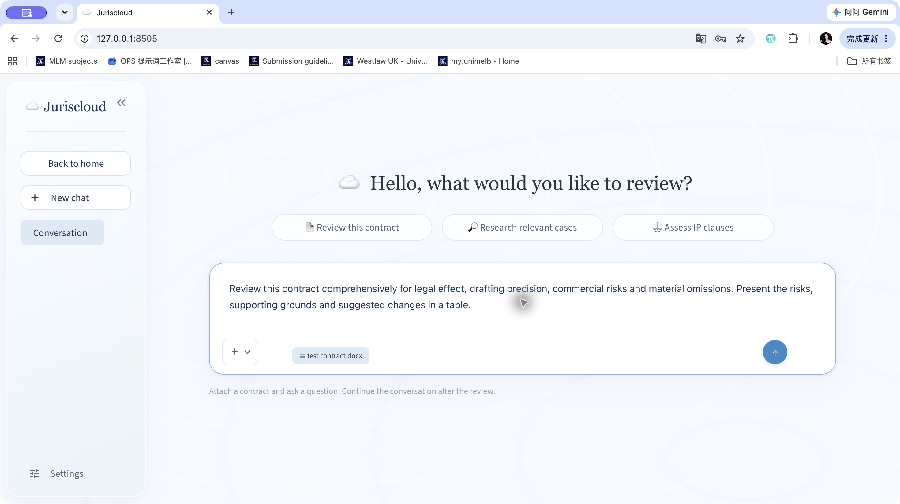
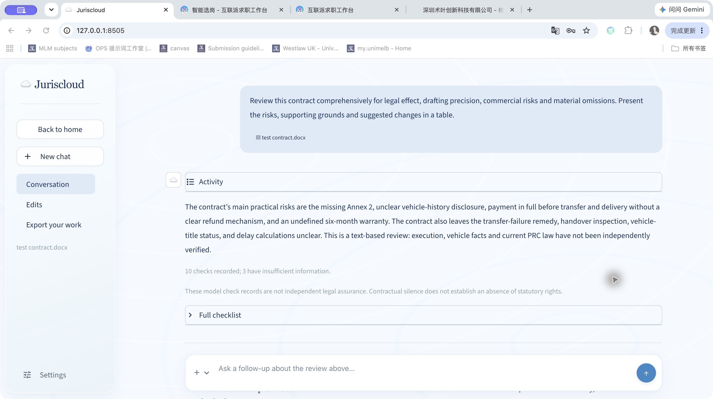
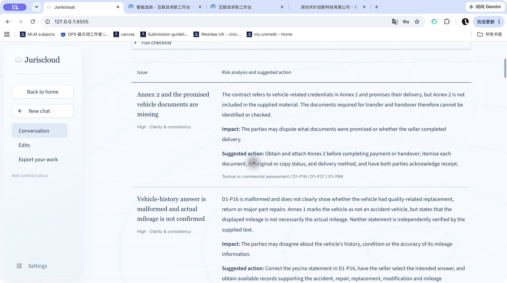
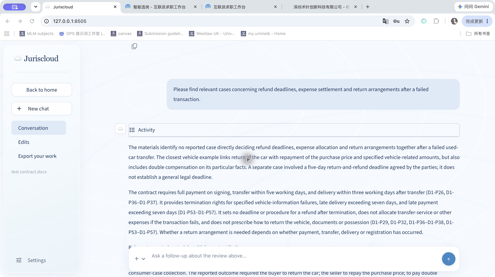
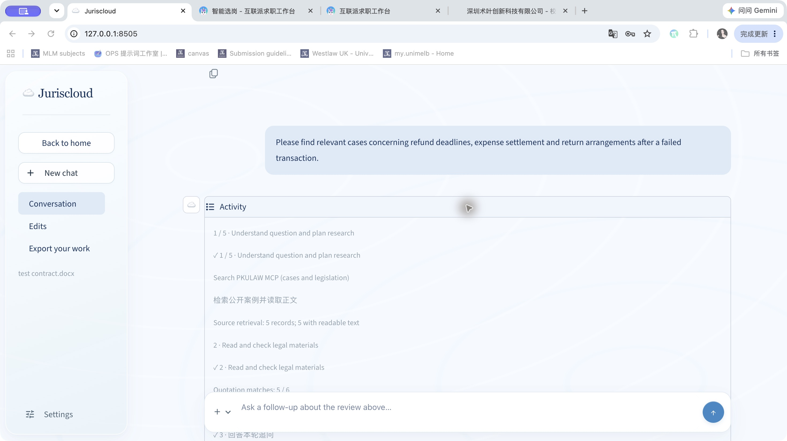
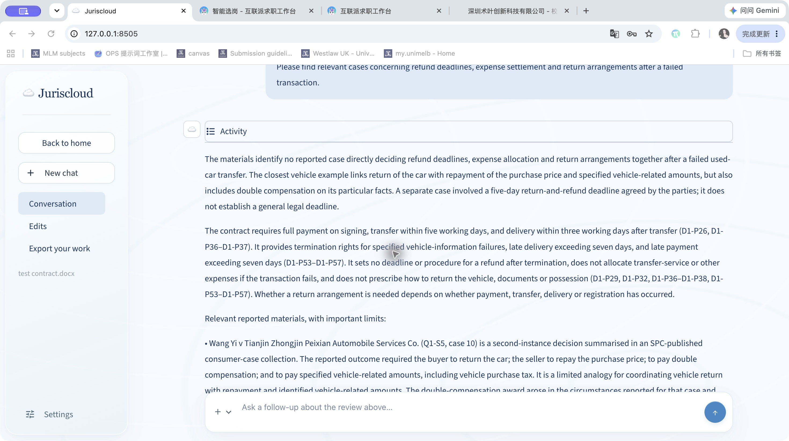
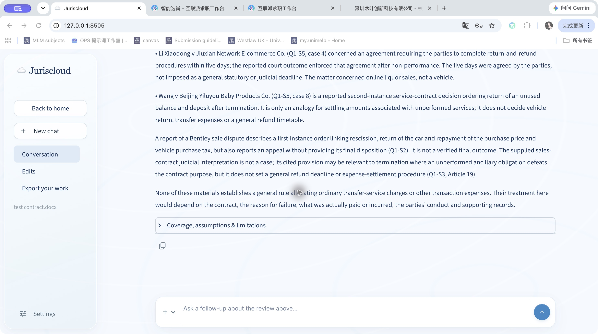
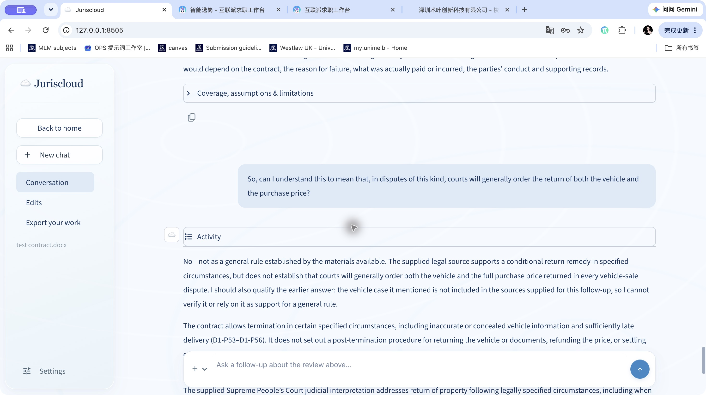
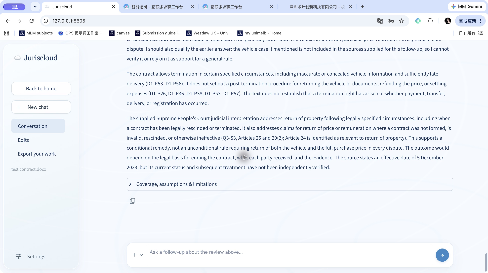

# Juriscloud Live English Functional Tests

This report records three completed live English tests of Juriscloud: uploading and reviewing a contract, researching cases about a contract issue, and asking a contextual follow-up. All three completed in the same conversation. The evidence demonstrates functional execution, with legal verification and source continuity limitations described for each test.

## Environment

Application: Juriscloud at http://127.0.0.1:8505/. Jurisdiction: Mainland China. Interface and answer language: English. Analysis and search model: gpt-6-luna. Input: test contract.docx, the same Chinese-language used-car sale contract used in the earlier test. The original document was not translated or altered.

## Method

The final run took place on 1 November 2026 in Melbourne time. The user supplied the original Word contract and model connection. Three English prompts were submitted sequentially through the application without starting a new conversation or changing the contract. Screenshots capture actual inputs and generated outputs. The answers are new English generations, not translations of earlier Chinese responses. Earlier interrupted attempts are documented in execution notes. Functional completion does not independently verify legal accuracy, complete judgments or subsequent judicial treatment.

## TC01 Upload a contract and ask a review question

**Objective:** Verify that the application accepts a Word contract and generates a contract-specific review in English.

**Preconditions:** A fresh session with Mainland China selected, English interface and output, a valid model connection, and the original test contract.docx.

### Actual input

> Review this contract comprehensively for legal effect, drafting precision, commercial risks and material omissions. Present the risks, supporting grounds and suggested changes in a table.

### Steps

1. Attach test contract.docx using the upload control.
2. Enter the English comprehensive-review prompt and submit it.
3. Wait for completion and inspect the report, table, paragraph references and limitations.

### Expected result

- The uploaded filename remains associated with the request.
- A new English report addresses the contract, with risks, supporting references and suggested action.
- Missing information and limits of legal verification are disclosed.

### Observed result

- The uploaded test contract.docx remained associated with the English review request.
- The agent generated a new English summary and a table containing fourteen contract issues, with paragraph references, impacts and suggested actions.
- The checklist recorded ten checks, three with insufficient information. Issues included missing Annex 2, full payment before transfer, warranty wording and post-termination settlement.
- The activity record showed public-source and PKULAW research, two topic batches and an omissions check. Quotation matches were reported as 0 / 0.

**Actual answer excerpt:**

> The contract’s main practical risks are the missing Annex 2, unclear vehicle-history disclosure, payment in full before transfer and delivery without a clear refund mechanism, and an undefined six-month warranty.

**Assessment:** The upload and English contract-review workflow completed. This establishes functional execution, not comprehensive legal correctness.

**Limitations:** No legal quotation match was recorded. The underlying legal conclusions, completeness and execution status of the contract were not independently verified.

### Screenshots

Uploaded document and English review prompt

Actual English contract review summary

Contract risk table with paragraph references

## TC02 Research cases concerning a contract issue

**Objective:** Verify focused case research about refund deadlines, expense settlement and return arrangements after a failed transaction.

**Preconditions:** Continue TC01 in the same conversation with the uploaded contract retained, English output selected and PKULAW research enabled.

### Actual input

> Please find relevant cases concerning refund deadlines, expense settlement and return arrangements after a failed transaction.

### Steps

1. Enter the English case-research prompt in the follow-up composer.
2. Submit and inspect the Activity record and generated answer.
3. Check case identifiers, connection to contract paragraphs, source labels and applicability limits.

### Expected result

- The answer focuses on the requested issue rather than repeating the full review.
- PKULAW is searched first, with public case research used when the returned evidence is insufficient.
- Any retrieved cases are identified and their factual differences and verification limits are explained.

### Observed result

- The English prompt received a focused answer about refunds, expenses and return arrangements rather than a repeat of the risk table.
- The Activity record showed PKULAW research before public-source retrieval. Five records had readable text; quotation matches were reported as 5 / 6.
- The answer connected the research question to payment, transfer, delivery and termination paragraphs D1-P26, D1-P36 to D1-P37 and D1-P53 to D1-P57.
- The agent discussed reported vehicle, online-sale and service-contract decisions. It distinguished a five-day party-agreed settlement timetable from a general legal deadline and disclosed incomplete or non-final case material.

**Actual answer excerpt:**

> The materials identify no reported case directly deciding refund deadlines, expense allocation and return arrangements together after a failed used-car transfer.

**Assessment:** Focused case research and the PKULAW-first sequence completed. The response differentiated the examples and their limits; some case identification and finality remained incomplete.

**Limitations:** Some Activity labels remained Chinese in the English interface. Quotation matching was 5 / 6, not complete. Case summaries, legal accuracy and subsequent treatment were not independently verified.

### Screenshots

English case research question and answer

PKULAW first research and quotation matching

Reported case comparisons

Expense allocation and case limitations

## TC03 Continue with a contextual follow-up

**Objective:** Verify that the agent understands a follow-up referring to the preceding cases and responds to a proposed generalisation.

**Preconditions:** Continue TC02 without starting a new conversation or uploading a different contract.

### Actual input

> So, can I understand this to mean that, in disputes of this kind, courts will generally order the return of both the vehicle and the purchase price?

### Steps

1. Submit the English follow-up asking whether courts generally order return of both the vehicle and purchase price.
2. Inspect whether the answer addresses that proposition directly.
3. Check continuity with the previous cases and contract, and whether necessary qualifications are retained.

### Expected result

- The answer resolves the contextual reference to disputes of this kind.
- It distinguishes the cited case outcomes from a universal or generally established result.
- It gives a targeted response rather than reproducing the initial risk table.

### Observed result

- The follow-up completed in English in the same conversation immediately after TC02, without a new upload.
- The answer directly rejected the proposed generalisation and distinguished conditional return remedies from an automatic return of both vehicle and full purchase price.
- It referred to the earlier answer and the same contract paragraphs, including D1-P26, D1-P36 to D1-P38 and D1-P53 to D1-P57. It did not reproduce the initial risk table.
- The agent stated that the vehicle case discussed previously was not included in the current evidence set and could not be verified for this follow-up.

**Actual answer excerpt:**

> No—not as a general rule established by the materials available. The supplied legal source supports a conditional return remedy in specified circumstances, but does not establish that courts will generally order both the vehicle and the full purchase price returned in every vehicle-sale dispute.

**Assessment:** Contextual follow-up functionality completed: the response addressed the proposition, retained the contract context and qualified the earlier answer. Evidence continuity was partial because the earlier case material was not retained in the current research set.

**Limitations:** The agent could not reverify the preceding vehicle case from its current sources. Its interpretation of the legal provisions and their current status were not independently checked. Functional completion is not a legal accuracy certification.

### Screenshots

Contextual English follow up and direct answer

Contract context and conditional legal analysis

## Supporting records

The package includes observed UI records, selected response text and screenshots. Long accessibility text nodes may be truncated; the records are not presented as complete verbatim answers. Credentials are not included. The user supplied the original filled contract after preparation of the historical Word report; it is now included unchanged in [inputs/](inputs/README.md), with a provenance and handling note. Timing entries record submission and first observation of completion; they are not precise server latency measurements.

## Updated input for future tests

The user has replaced the current test input with [Used Vehicle Sale and Purchase Agreement English.docx](inputs/Used%20Vehicle%20Sale%20and%20Purchase%20Agreement%20English.docx). A live rerun with that file is pending. All observed results and screenshots above remain evidence of the original Chinese-input run. The Chinese input is retained for historical reproducibility; see [input provenance](inputs/README.md).
